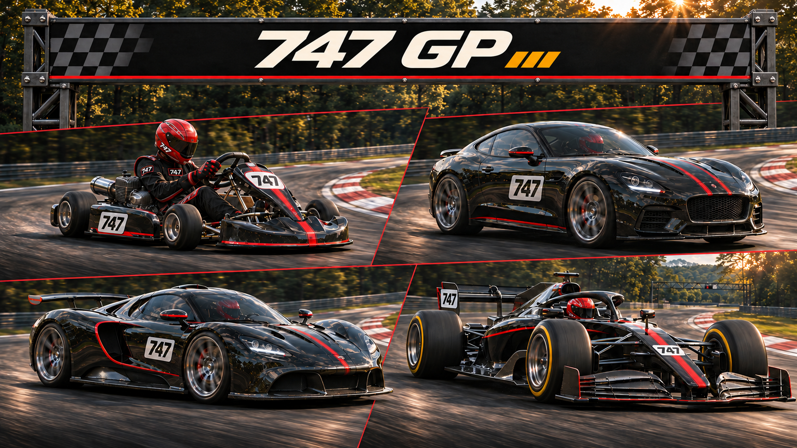
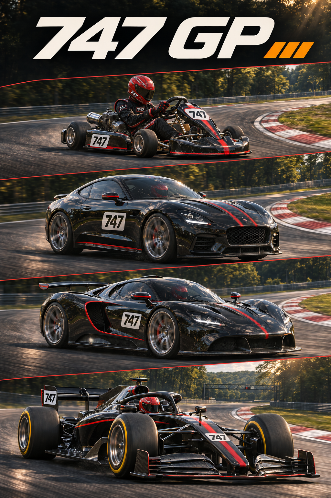
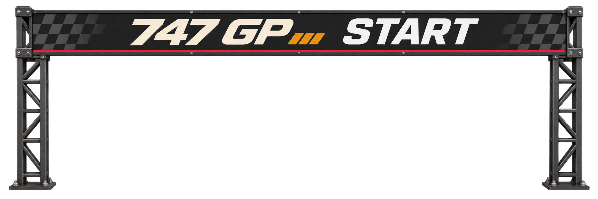
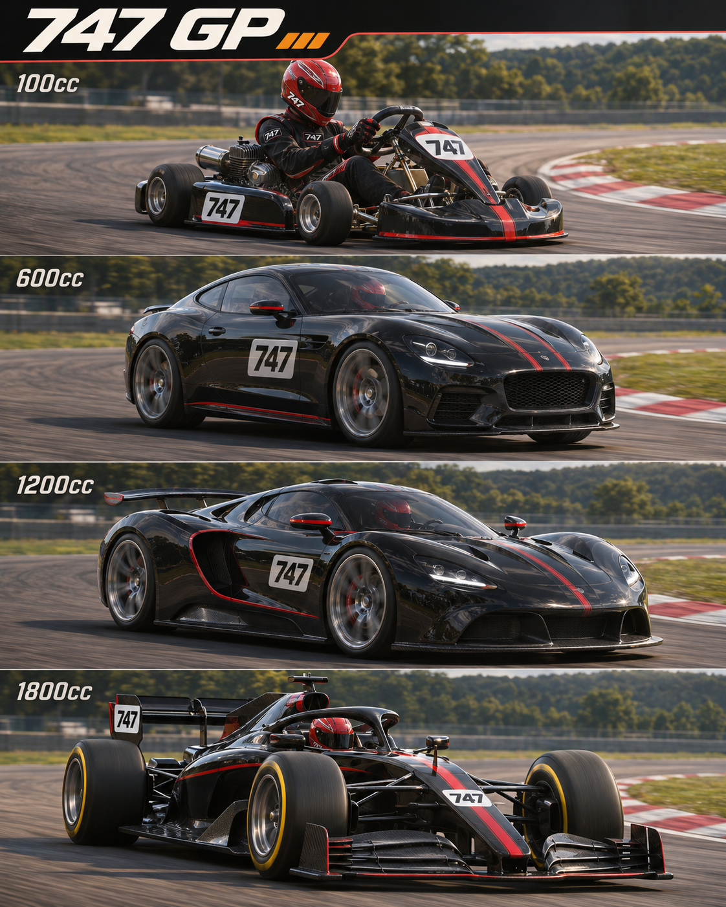
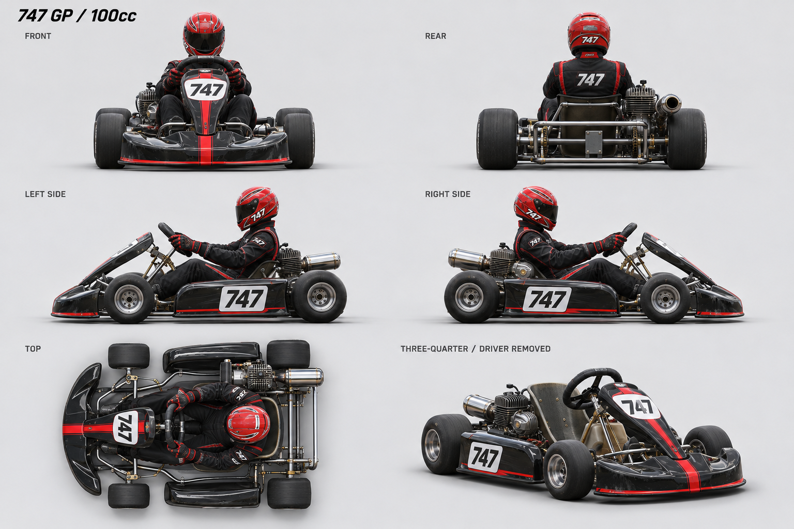
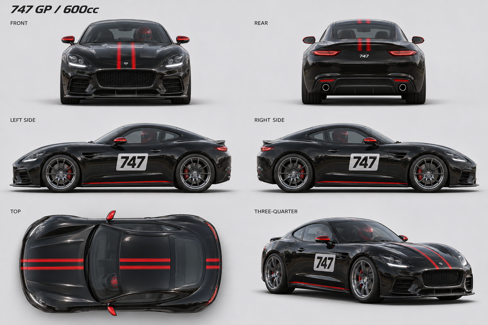
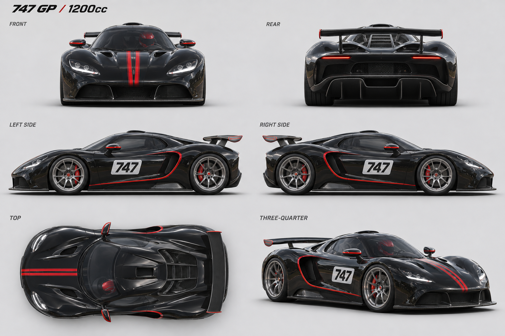
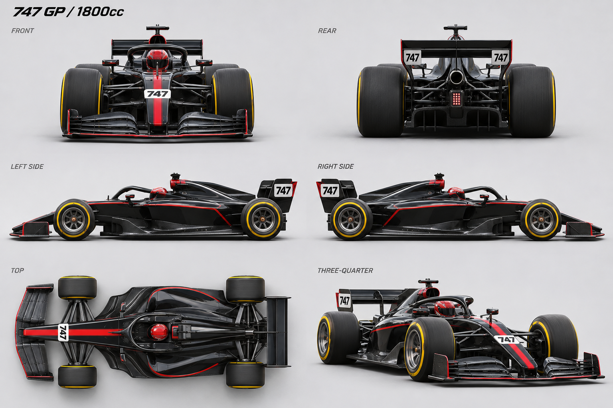
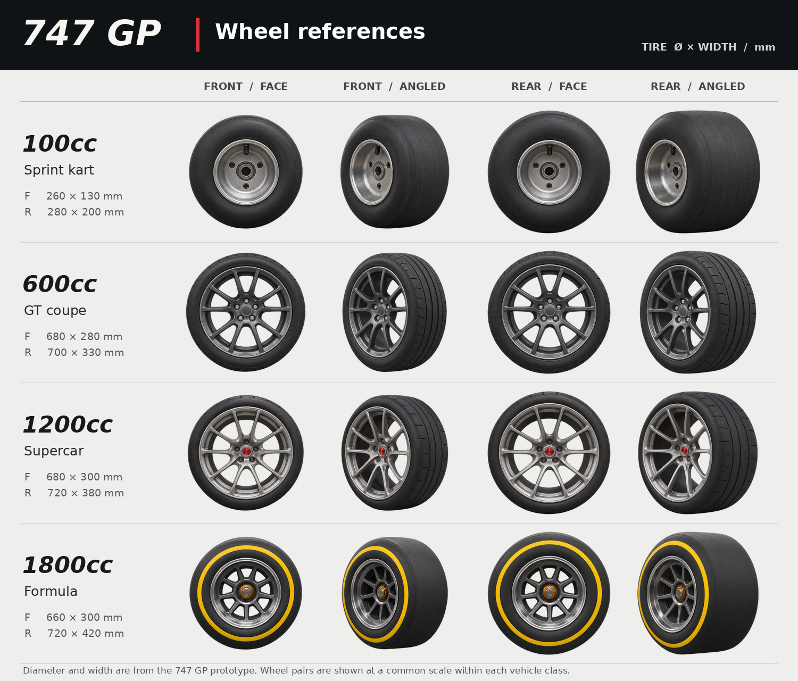
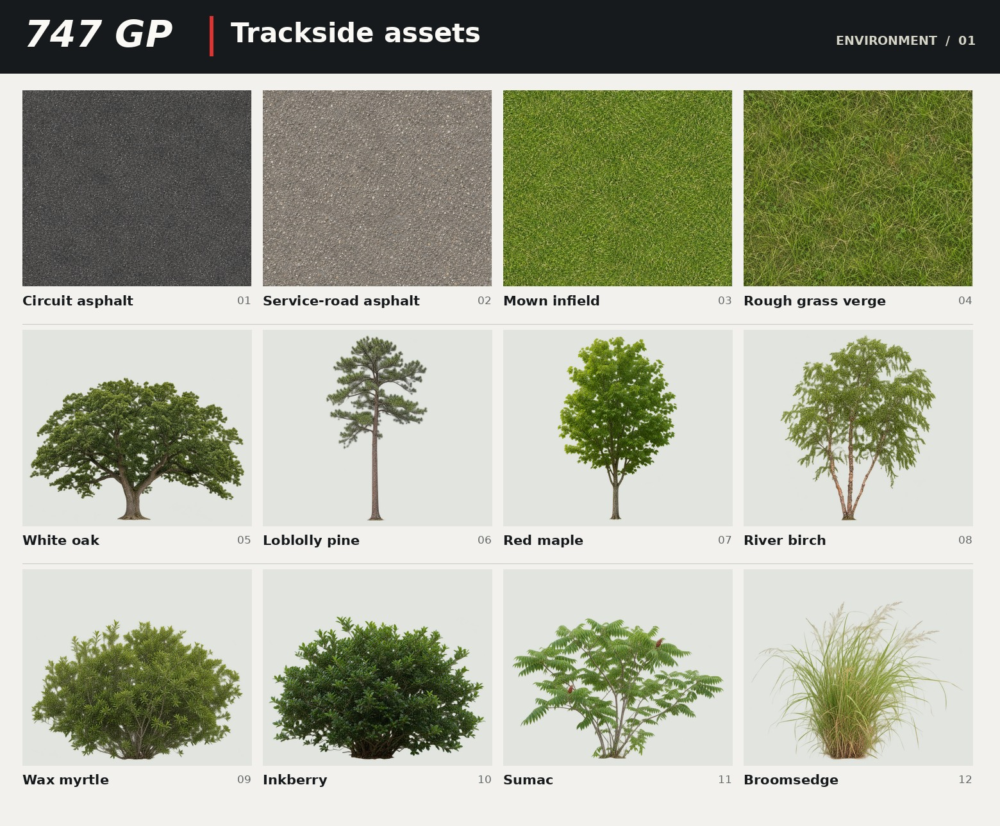

# 747 GP artwork collection

Artwork created with Jeremy for 747 GP, assembled November 17, 2026. This collection contains 55 images, the wheel dimension table, and the original usage notes.

The current landscape cover uses a centered **747 GP** wordmark with the three amber stripes. **START** is reserved for the race gantry. The earlier landscape cover with START remains in the history folder.

## Covers and race banner

| Current landscape cover | Portrait cover |
| --- | --- |
|  |  |

| Asset | Image size | Intended placement |
| --- | --- | --- |
| [Landscape cover](covers/747-gp-landscape.png) | 1672 × 941 | Landscape title screen, game shelf, or loading screen |
| [Portrait cover](covers/747-gp-portrait.png) | 1024 × 1536 | Portrait game case, shelf, or promotional image |
| [Race start gantry](banners/747-gp-start-gantry.png) | 2172 × 724, transparent | Overhead race start banner or modeling reference |
| [Earlier landscape cover](covers/history/747-gp-landscape-start-v1.png) | 1672 × 941 | Design history, with the original START wording |

## Vehicle designs

The original lineup establishes the gloss-black bodywork, race-red accents, white 747 number boards, and photorealistic direction. Each turnaround provides front, rear, left, right, top, and three-quarter views. The kart includes a three-quarter view with the driver removed.

| Original lineup | Kart | GT coupe | Supercar | Formula car |
| --- | --- | --- | --- | --- |
|  |  |  |  |  |

The lineup remains the visual reference for the approved vehicle curves. Surfaces concealed in that first image, such as rear lamps and diffusers, were interpreted in the turnarounds.

## Wheels for modeling

Each class has a front and rear wheel design. The files in [meshy-pairs](wheels/meshy-pairs/) contain one wheel in two views per image, with the dead-on face at left and the angled view at right. There are eight files, one for each axle and class.

| Class | Front wheel | Rear wheel |
| --- | --- | --- |
| 100cc kart | [Front pair](wheels/meshy-pairs/747-GP-100cc-Kart-Front-Wheel.png) | [Rear pair](wheels/meshy-pairs/747-GP-100cc-Kart-Rear-Wheel.png) |
| 600cc GT | [Front pair](wheels/meshy-pairs/747-GP-600cc-GT-Front-Wheel.png) | [Rear pair](wheels/meshy-pairs/747-GP-600cc-GT-Rear-Wheel.png) |
| 1200cc supercar | [Front pair](wheels/meshy-pairs/747-GP-1200cc-Supercar-Front-Wheel.png) | [Rear pair](wheels/meshy-pairs/747-GP-1200cc-Supercar-Rear-Wheel.png) |
| 1800cc Formula | [Front pair](wheels/meshy-pairs/747-GP-1800cc-Formula-Front-Wheel.png) | [Rear pair](wheels/meshy-pairs/747-GP-1800cc-Formula-Rear-Wheel.png) |

The [four original atlases](wheels/atlases/) preserve the first wheel renders. [Single views](wheels/single-views/) contains the sixteen individual transparent 640 × 640 PNGs. The [dimension table](wheels/wheel-dimensions-mm.csv) records tire outer diameter and width from the original game prototype in millimeters. Further placement details appear in the [modeling notes](wheels/modeling-notes.txt).

## Track textures and greenery

[Ground](environment/ground/) contains four prepared 1024 × 1024 repeating textures. [Originals](environment/ground/originals/) preserves the larger generated texture images from which those tiles were prepared.

[Vegetation](environment/vegetation/) contains eight individual transparent cutouts of white oak, loblolly pine, red maple, river birch, wax myrtle, inkberry, sumac, and broomsedge. Scale each plant independently while preserving its image proportions. These single-angle views suit upright camera-facing planes. The original [usage notes](environment/using-the-assets.txt) include placement guidance.

## Design history

1. The initial four-class poster established the 747 GP identity and the four approved black-and-red vehicle designs.
2. The vehicle turnarounds expanded each design into views for 3D modeling.
3. The trackside set added asphalt, grass, and transparent plants. Prepared texture tiles followed the original ground images.
4. Wheel atlases became individual front and rear views, then eight paired images for the Meshy workflow.
5. The overhead race gantry introduced the 747 GP START banner. A portrait cover followed with all four vehicles.
6. The first landscape cover brought the gantry and four vehicles together.
7. The current landscape cover centers 747 GP and the amber stripes on the gantry. START remains on the dedicated race banner.

## Integration points

Paths here are relative to this artwork directory. From the game entry point at `747GP/index.html`, use `artwork/covers/747-gp-landscape.png` and `artwork/covers/747-gp-portrait.png` for future cover or title-screen work. Preserve each image's proportions and allow room for the separate start-race control.

The current track-building code creates its gantry under the `start/finish gantry + grid line` comment and draws its sign with `canvasTex`. The PNG at `artwork/banners/747-gp-start-gantry.png` includes both the sign and support columns. Its transparent open span and truss gaps should remain transparent when preparing a billboard or model reference. Its full frame includes the support structure, so the sign face needs its own crop for use on the existing beam mesh.

The game already loads vehicle models from `cars/`, wheels from `cars/wheels/`, and ground and vegetation images through `VEG_FILES` in `index.html`. This collection supplies source artwork and reference exports for future integration. Runtime integration of the new covers and banner is pending.

## Complete image inventory

The links below preserve each image's role, dimensions, transparency, and source export name.

| Image | Pixels | Transparency | Source export |
| --- | --- | --- | --- |
| [banners/747-gp-start-gantry.png](banners/747-gp-start-gantry.png) | 2172 × 724 | Alpha | exec-f9de8eab-565f-4f2b-be35-94cb5f802094.png |
| [covers/747-gp-landscape.png](covers/747-gp-landscape.png) | 1672 × 941 | Opaque | exec-3e059908-bcd5-4510-9163-60bb58c1a757.png |
| [covers/747-gp-portrait.png](covers/747-gp-portrait.png) | 1024 × 1536 | Opaque | exec-315f1faa-8afd-44ea-a3bb-073f8e52a98b.png |
| [covers/history/747-gp-landscape-start-v1.png](covers/history/747-gp-landscape-start-v1.png) | 1672 × 941 | Opaque | exec-4cbf3751-63d7-4c48-9098-3c4254c58b93.png |
| [environment/ground/asphalt-circuit.png](environment/ground/asphalt-circuit.png) | 1024 × 1024 | Opaque | 747-GP-Trackside-Assets.zip / Ground/asphalt-circuit.png |
| [environment/ground/asphalt-service-road.png](environment/ground/asphalt-service-road.png) | 1024 × 1024 | Opaque | 747-GP-Trackside-Assets.zip / Ground/asphalt-service-road.png |
| [environment/ground/grass-mown-infield.png](environment/ground/grass-mown-infield.png) | 1024 × 1024 | Opaque | 747-GP-Trackside-Assets.zip / Ground/grass-mown-infield.png |
| [environment/ground/grass-rough-verge.png](environment/ground/grass-rough-verge.png) | 1024 × 1024 | Opaque | 747-GP-Trackside-Assets.zip / Ground/grass-rough-verge.png |
| [environment/ground/originals/asphalt-circuit.png](environment/ground/originals/asphalt-circuit.png) | 1254 × 1254 | Opaque | Charcoal-gray racing asphalt texture.png |
| [environment/ground/originals/asphalt-service-road.png](environment/ground/originals/asphalt-service-road.png) | 1254 × 1254 | Opaque | Weathered Warm-Gray Service Road Asphalt.png |
| [environment/ground/originals/grass-mown-infield.png](environment/ground/originals/grass-mown-infield.png) | 1254 × 1254 | Opaque | Seamless close-mown fescue lawn texture.png |
| [environment/ground/originals/grass-rough-verge.png](environment/ground/originals/grass-rough-verge.png) | 1254 × 1254 | Opaque | Uneven roadside meadow grass texture.png |
| [environment/vegetation/grass-broomsedge-clump.png](environment/vegetation/grass-broomsedge-clump.png) | 1448 × 1086 | Alpha | 747-GP-Trackside-Assets.zip / Vegetation/grass-broomsedge-clump.png |
| [environment/vegetation/shrub-inkberry.png](environment/vegetation/shrub-inkberry.png) | 1536 × 1024 | Alpha | 747-GP-Trackside-Assets.zip / Vegetation/shrub-inkberry.png |
| [environment/vegetation/shrub-sumac.png](environment/vegetation/shrub-sumac.png) | 1536 × 1024 | Alpha | 747-GP-Trackside-Assets.zip / Vegetation/shrub-sumac.png |
| [environment/vegetation/shrub-wax-myrtle.png](environment/vegetation/shrub-wax-myrtle.png) | 1536 × 1024 | Alpha | 747-GP-Trackside-Assets.zip / Vegetation/shrub-wax-myrtle.png |
| [environment/vegetation/tree-loblolly-pine.png](environment/vegetation/tree-loblolly-pine.png) | 1024 × 1536 | Alpha | 747-GP-Trackside-Assets.zip / Vegetation/tree-loblolly-pine.png |
| [environment/vegetation/tree-red-maple.png](environment/vegetation/tree-red-maple.png) | 1024 × 1536 | Alpha | 747-GP-Trackside-Assets.zip / Vegetation/tree-red-maple.png |
| [environment/vegetation/tree-river-birch.png](environment/vegetation/tree-river-birch.png) | 1146 × 1372 | Alpha | 747-GP-Trackside-Assets.zip / Vegetation/tree-river-birch.png |
| [environment/vegetation/tree-white-oak.png](environment/vegetation/tree-white-oak.png) | 1536 × 1024 | Alpha | 747-GP-Trackside-Assets.zip / Vegetation/tree-white-oak.png |
| [environment/visual-index.jpg](environment/visual-index.jpg) | 1560 × 1290 | Opaque | 747-GP-Trackside-Assets.zip / Visual-index.jpg |
| [vehicles/100cc-kart-turnaround.png](vehicles/100cc-kart-turnaround.png) | 1536 × 1024 | Opaque | 747 GP 100cc Kart Turnaround.png |
| [vehicles/1200cc-supercar-turnaround.png](vehicles/1200cc-supercar-turnaround.png) | 1536 × 1024 | Opaque | 747 GP 1200cc six-view turnaround.png |
| [vehicles/1800cc-formula-turnaround.png](vehicles/1800cc-formula-turnaround.png) | 1536 × 1024 | Opaque | 747 GP 1800cc racecar turnaround.png |
| [vehicles/600cc-gt-turnaround.png](vehicles/600cc-gt-turnaround.png) | 1536 × 1024 | Opaque | 747 GP 600cc GT turnaround sheet.png |
| [vehicles/747-gp-original-lineup.png](vehicles/747-gp-original-lineup.png) | 1122 × 1402 | Opaque | 747 GP.png |
| [wheels/atlases/100cc-kart.png](wheels/atlases/100cc-kart.png) | 1254 × 1254 | Alpha | Competition kart wheel component set.png |
| [wheels/atlases/1200cc-supercar.png](wheels/atlases/1200cc-supercar.png) | 1254 × 1254 | Alpha | Four-View Titanium Supercar Wheel Atlas.png |
| [wheels/atlases/1800cc-formula.png](wheels/atlases/1800cc-formula.png) | 1254 × 1254 | Alpha | Formula Racecar Wheel View Atlas.png |
| [wheels/atlases/600cc-gt.png](wheels/atlases/600cc-gt.png) | 1254 × 1254 | Alpha | Graphite GT Wheel Four-View Atlas.png |
| [wheels/meshy-pairs/747-GP-100cc-Kart-Front-Wheel.png](wheels/meshy-pairs/747-GP-100cc-Kart-Front-Wheel.png) | 1280 × 640 | Alpha | 747-GP-Eight-Wheel-Pairs.zip / 747-GP-100cc-Kart-Front-Wheel.png |
| [wheels/meshy-pairs/747-GP-100cc-Kart-Rear-Wheel.png](wheels/meshy-pairs/747-GP-100cc-Kart-Rear-Wheel.png) | 1280 × 640 | Alpha | 747-GP-Eight-Wheel-Pairs.zip / 747-GP-100cc-Kart-Rear-Wheel.png |
| [wheels/meshy-pairs/747-GP-1200cc-Supercar-Front-Wheel.png](wheels/meshy-pairs/747-GP-1200cc-Supercar-Front-Wheel.png) | 1280 × 640 | Alpha | 747-GP-Eight-Wheel-Pairs.zip / 747-GP-1200cc-Supercar-Front-Wheel.png |
| [wheels/meshy-pairs/747-GP-1200cc-Supercar-Rear-Wheel.png](wheels/meshy-pairs/747-GP-1200cc-Supercar-Rear-Wheel.png) | 1280 × 640 | Alpha | 747-GP-Eight-Wheel-Pairs.zip / 747-GP-1200cc-Supercar-Rear-Wheel.png |
| [wheels/meshy-pairs/747-GP-1800cc-Formula-Front-Wheel.png](wheels/meshy-pairs/747-GP-1800cc-Formula-Front-Wheel.png) | 1280 × 640 | Alpha | 747-GP-Eight-Wheel-Pairs.zip / 747-GP-1800cc-Formula-Front-Wheel.png |
| [wheels/meshy-pairs/747-GP-1800cc-Formula-Rear-Wheel.png](wheels/meshy-pairs/747-GP-1800cc-Formula-Rear-Wheel.png) | 1280 × 640 | Alpha | 747-GP-Eight-Wheel-Pairs.zip / 747-GP-1800cc-Formula-Rear-Wheel.png |
| [wheels/meshy-pairs/747-GP-600cc-GT-Front-Wheel.png](wheels/meshy-pairs/747-GP-600cc-GT-Front-Wheel.png) | 1280 × 640 | Alpha | 747-GP-Eight-Wheel-Pairs.zip / 747-GP-600cc-GT-Front-Wheel.png |
| [wheels/meshy-pairs/747-GP-600cc-GT-Rear-Wheel.png](wheels/meshy-pairs/747-GP-600cc-GT-Rear-Wheel.png) | 1280 × 640 | Alpha | 747-GP-Eight-Wheel-Pairs.zip / 747-GP-600cc-GT-Rear-Wheel.png |
| [wheels/single-views/100cc-kart/100cc-kart-front-angled.png](wheels/single-views/100cc-kart/100cc-kart-front-angled.png) | 640 × 640 | Alpha | 747-GP-Wheel-References.zip / 100cc-kart/100cc-kart-front-angled.png |
| [wheels/single-views/100cc-kart/100cc-kart-front-face.png](wheels/single-views/100cc-kart/100cc-kart-front-face.png) | 640 × 640 | Alpha | 747-GP-Wheel-References.zip / 100cc-kart/100cc-kart-front-face.png |
| [wheels/single-views/100cc-kart/100cc-kart-rear-angled.png](wheels/single-views/100cc-kart/100cc-kart-rear-angled.png) | 640 × 640 | Alpha | 747-GP-Wheel-References.zip / 100cc-kart/100cc-kart-rear-angled.png |
| [wheels/single-views/100cc-kart/100cc-kart-rear-face.png](wheels/single-views/100cc-kart/100cc-kart-rear-face.png) | 640 × 640 | Alpha | 747-GP-Wheel-References.zip / 100cc-kart/100cc-kart-rear-face.png |
| [wheels/single-views/1200cc-supercar/1200cc-supercar-front-angled.png](wheels/single-views/1200cc-supercar/1200cc-supercar-front-angled.png) | 640 × 640 | Alpha | 747-GP-Wheel-References.zip / 1200cc-supercar/1200cc-supercar-front-angled.png |
| [wheels/single-views/1200cc-supercar/1200cc-supercar-front-face.png](wheels/single-views/1200cc-supercar/1200cc-supercar-front-face.png) | 640 × 640 | Alpha | 747-GP-Wheel-References.zip / 1200cc-supercar/1200cc-supercar-front-face.png |
| [wheels/single-views/1200cc-supercar/1200cc-supercar-rear-angled.png](wheels/single-views/1200cc-supercar/1200cc-supercar-rear-angled.png) | 640 × 640 | Alpha | 747-GP-Wheel-References.zip / 1200cc-supercar/1200cc-supercar-rear-angled.png |
| [wheels/single-views/1200cc-supercar/1200cc-supercar-rear-face.png](wheels/single-views/1200cc-supercar/1200cc-supercar-rear-face.png) | 640 × 640 | Alpha | 747-GP-Wheel-References.zip / 1200cc-supercar/1200cc-supercar-rear-face.png |
| [wheels/single-views/1800cc-formula/1800cc-formula-front-angled.png](wheels/single-views/1800cc-formula/1800cc-formula-front-angled.png) | 640 × 640 | Alpha | 747-GP-Wheel-References.zip / 1800cc-formula/1800cc-formula-front-angled.png |
| [wheels/single-views/1800cc-formula/1800cc-formula-front-face.png](wheels/single-views/1800cc-formula/1800cc-formula-front-face.png) | 640 × 640 | Alpha | 747-GP-Wheel-References.zip / 1800cc-formula/1800cc-formula-front-face.png |
| [wheels/single-views/1800cc-formula/1800cc-formula-rear-angled.png](wheels/single-views/1800cc-formula/1800cc-formula-rear-angled.png) | 640 × 640 | Alpha | 747-GP-Wheel-References.zip / 1800cc-formula/1800cc-formula-rear-angled.png |
| [wheels/single-views/1800cc-formula/1800cc-formula-rear-face.png](wheels/single-views/1800cc-formula/1800cc-formula-rear-face.png) | 640 × 640 | Alpha | 747-GP-Wheel-References.zip / 1800cc-formula/1800cc-formula-rear-face.png |
| [wheels/single-views/600cc-gt/600cc-gt-front-angled.png](wheels/single-views/600cc-gt/600cc-gt-front-angled.png) | 640 × 640 | Alpha | 747-GP-Wheel-References.zip / 600cc-gt/600cc-gt-front-angled.png |
| [wheels/single-views/600cc-gt/600cc-gt-front-face.png](wheels/single-views/600cc-gt/600cc-gt-front-face.png) | 640 × 640 | Alpha | 747-GP-Wheel-References.zip / 600cc-gt/600cc-gt-front-face.png |
| [wheels/single-views/600cc-gt/600cc-gt-rear-angled.png](wheels/single-views/600cc-gt/600cc-gt-rear-angled.png) | 640 × 640 | Alpha | 747-GP-Wheel-References.zip / 600cc-gt/600cc-gt-rear-angled.png |
| [wheels/single-views/600cc-gt/600cc-gt-rear-face.png](wheels/single-views/600cc-gt/600cc-gt-rear-face.png) | 640 × 640 | Alpha | 747-GP-Wheel-References.zip / 600cc-gt/600cc-gt-rear-face.png |
| [wheels/wheel-reference-index.jpg](wheels/wheel-reference-index.jpg) | 1500 × 1280 | Opaque | 747-GP-Wheel-References.zip / Wheel-reference-index.jpg |
