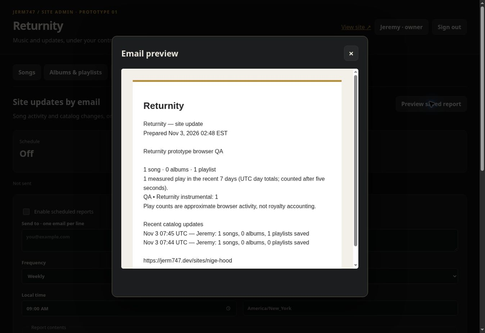

# Returnity Site Admin — prototype 01

Returnity is the first integrated installation of Jerm747 Site Admin. The console controls the existing player at `sites/nige-hood/`; it is not a separate demo. It has Songs, Albums & playlists, Explicit & language, and Email reports. Account controls are under the signed-in name. There are no Network, games, newsletter or subscriber management tabs.

## First use on GoDaddy

1. Build the dev site with `npm ci` and `npm run build`. Upload the contents of `dist/` to the existing jerm747.dev folder, including hidden `.htaccess` files. Keep the existing `api/data/` folder and all existing audio files. Do not deploy by deleting the destination first.
2. Open `https://jerm747.dev/sites/nige-hood/admin/`. Sign in as **jeremy** with the existing dev-site admin password. This only works after the parent dev admin has been configured; there is no public first-visitor registration flow.
3. Select **Jeremy · owner → Change my password** to set an independent Returnity password. The parent dev password and other sites remain unchanged. From then on, Jeremy uses the new Returnity password for this console.
4. Select **Create activation link**. The default account is **nige**, name **Nige**. Copy the private link and share it with him through your preferred channel. No invitation email is sent by this feature. The link expires in 48 hours and works once; Nige chooses his own password. Reissuing a link revokes the existing account until it is activated again.
5. Both accounts can manage the Returnity catalog and reports. Only Jeremy can create or disable site administrators. Disabling an account or changing its password invalidates its existing sessions. Neither account grants access to the parent development portal or another client's site.

No production passwords, activation tokens or recipient addresses are included in this repository. Password hashes, sessions, report recipients and schedules are kept below `api/data/site-admin/returnity/`. The existing parent `.htaccess` and `api/data/.htaccess` block HTTP access to that directory. Preserve those protections when deploying. PHP 8.0+ and Apache 2.4 are expected; the existing dev portal already uses PHP 8 APIs. HTTPS is required in production.

## Songs, albums and playlists

- Upload audio using your hosting tools to `sites/nige-hood/audio/` or `sites/nige-hood/music/`, then choose **Scan audio folders**. It adds only local audio files, skips symlinks, and creates unpublished drafts. Audio upload is intentionally not part of this first admin version.
- Alternatively, **Add song** accepts an HTTPS audio URL or a relative path in this site's audio/music/uploads folders. Enter title, artists, album, tempo, date, language code and song type. Review the explicit flag, then check **Publish**.
- **Apply changes** updates the open editor; **Save catalog** persists the complete catalog to the server. Changes appear on the next page load without rebuilding. Optimistic revisions prevent Jeremy and Nige from silently overwriting each other's saves. If a conflict appears, preserve the edits you need and reload the saved version.
- Arrow buttons set song order, including album order. Every song belongs to at most one album. A song can belong to many playlists, each with its own order. Removing a song removes its playlist membership but never deletes the audio file. Removing an album leaves its songs unassigned.
- Public visitors use **Playlists & listening** in the footer. Playlists use the same existing audio player and queue as the tape deck and music pages.
- Explicit songs are hidden by default. Visitors can opt in unless the site policy always blocks explicit songs. Instrumental/vocal/spoken-word choices filter the catalog before queues are built. The enabled explicit songs display `[E]` in their title. These labels do not detect lyrics or modify audio. The controls are playback preferences, not access controls over public audio URLs.
- Listener preferences are per-device, per-site. A catalog change does not interrupt an already open listening session; reload to apply the new catalog and policies. If the catalog API fails, the tour remains available and music fails closed rather than bypassing the content filters.

## Email reports

Reports start **off**, with no recipients. Add up to five recipients, select daily or weekly delivery, local time, timezone, and contents; then save. The report covers catalog totals, approximate song plays, and recent catalog-save activity. An optional opening note is plain text. This prototype is an owner/admin digest, not a subscriber newsletter or campaign tool.

**Preview saved report** sends nothing. **Send saved test** sends to the saved recipient list after a confirmation in the console. Accepted by the mail server does not prove inbox delivery. Verify delivery on the production host. The configured sender is `admin@jerm747.dev`; confirm that mailbox and GoDaddy email deliverability settings are ready.

To run schedules while nobody is visiting, add a cPanel cron job every five minutes (`*/5 * * * *`) using the command shown in Email reports. The cron entry calls this installation's `admin/cron.php` through PHP CLI. The HTTP route is disabled, and the command contains no authentication secret. PHP CLI must run as the same hosting account with write access to the private data directory. If cPanel requires a full executable path, use the PHP CLI path provided by your host.

Scheduling follows the selected IANA timezone, including daylight-saving changes. A due slot is claimed before sending and serialized with a lock. Missed slots do not cause a backlog of repeated messages. A refused message is recorded and the next scheduled slot is retained; it does not automatically retry an ambiguous send. If the process dies during sending, the status can remain uncertain—check host mail logs before sending another test.

Play counts start after five seconds of advancing audio and are limited by the server. They are approximate, can be affected by bots/client tampering, and are not royalty or billing records. Reports use recent UTC day totals (one or seven days), including the current partial day, rather than exact rolling-hour analytics. No visitor/network dashboard is included.

## Reuse and source boundary

Shared module: `public/site-admin/{core.php,admin.js,admin.css,listener.js,listener.css}`.

Returnity adapter: `public/sites/nige-hood/admin/{instance.php,api.php,cron.php,index.html}`. The adapter declares site ID, branding, site URL, base path, audio/config root, private data directory, bootstrap-owner name/username/hash path and sender. A later installation needs its own ID, data directory, cookie path and owner configuration; never share account/schedule storage across sites. Changing domains also requires updating the URL/base path and checking relative shared-asset paths.

The GitHub folder currently contains the **compiled** music player, not its original React source. `scripts/integrate-returnity-admin.mjs` preserves `assets/index-Cr6z48O5.js` and produces `assets/index-admin-v1.js` with five guarded integration points: catalog loading, player binding, footer controls and two empty-state messages. The script also namespaces the player's saved state for Returnity. It checks the original bundle hash and exact replacement matches before writing. The dev site's `prebuild` runs it automatically. When original player source becomes available, move these hooks into that source and retire this adapter; do not blindly patch a new generated bundle.

Catalog and album baseline files remain untouched. Once an admin saves, private runtime catalog state takes precedence over baseline `tracks.json` and the music-album portion of `site.config.json`. Tour, artwork, game configuration and other site settings still come from the existing config. Existing game files are unchanged.

## Checks

```sh
npm test
npm run build
PHP_BIN=/path/to/php npm run test:admin
```

The PHP integration test creates a temporary site and parent-password fixture, exercises authentication/roles/CSRF, account activation and revocation, password changes, independent sites, revision conflicts, URL validation, scanning, explicit/type filters, playlists, reports, duplicate cron protection, DST and rate limiting. Mail is captured to temporary files and no email leaves the test. Temporary credentials are never installed into a real site.

Publishing a GitHub branch/PR does not upload this change to GoDaddy. Build and deploy the files above, then complete the owner/Nige setup and host mail/cron verification.

## Tested preview

The screenshot below is from an isolated fixture with a generated test tone, not the live site. Creating and saving the song and playlist, playing the playlist through the existing deck, and seeing that play in the saved email preview were verified in the browser. No test email was sent.


